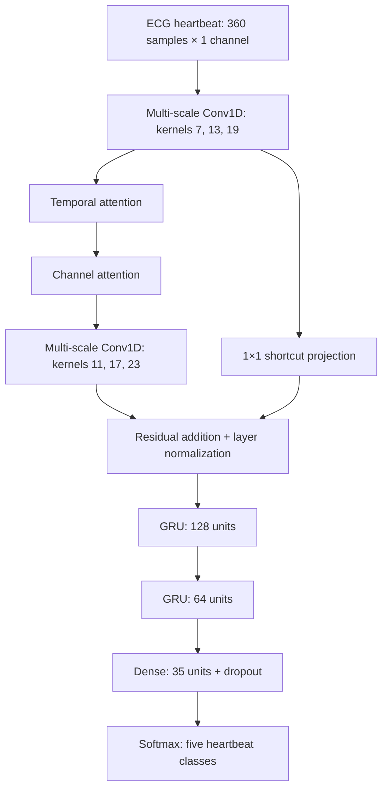

<div align="center">

# 🫀 Heart Arrhythmia Detection

### From ECG waveforms to explainable heartbeat predictions

**Signal processing · Deep learning · Explainable AI · Interactive inference**

[Overview](#overview) · [Architecture](#architecture) · [Quick start](#quick-start) · [Training](#training-and-evaluation) · [References](#references)

</div>

---

## Overview

An end-to-end ECG classification project that brings together physiological signal processing, deep learning, and an interactive web application. Trained on the **MIT-BIH Arrhythmia Database**, the model analyzes individual heartbeats and predicts one of five heartbeat classes.

At its core is **MSHAN — a Multi-Scale Hybrid Attention Network** combining 1D convolutions, temporal and channel attention, and stacked GRUs. A FastAPI backend serves predictions, while a Streamlit dashboard makes it easy to explore ECG waveforms, class probabilities, and signal-level explanations.

## Highlights

- **Multi-scale signal analysis** — parallel convolutional filters capture ECG patterns at different temporal scales.
- **Attention-guided learning** — temporal and channel attention reweight learned features before recurrent modeling.
- **Explainable predictions** — input × gradient highlights sample-level contributions in the dashboard; offline SHAP reports provide additional attribution views.
- **Interactive heartbeat analysis** — upload a segmented CSV or JSON heartbeat, or explore a real annotated PhysioNet example.
- **Detailed evaluation** — confusion matrices, ROC curves, precision, recall, specificity, and macro F1 complement overall accuracy.
- **Reproducible workflows** — shared preprocessing, seeded sampling, resumable training checkpoints, and model metadata connect training to inference.

## Heartbeat classes

| Code | Heartbeat type |
|:---:|---|
| **N** | Normal beat |
| **L** | Left bundle branch block beat |
| **R** | Right bundle branch block beat |
| **A** | Atrial premature beat |
| **V** | Premature ventricular contraction |

These classes correspond to the original MIT-BIH annotation symbols.

## Architecture



The first convolution stage uses **32 filters per branch**, and the second uses **64 filters per branch**. The network contains **499,748 trainable parameters**. Each input is normalized independently using the same preprocessing function during training and inference.

## Data workflow

1. **Acquire:** download MIT-BIH recordings directly from PhysioNet using WFDB.
2. **Segment:** extract 360-sample windows around annotated R-peaks, using the MLII lead where available.
3. **Normalize:** apply per-heartbeat Z-score normalization.
4. **Train:** balance the training partition through random oversampling and optimize the network with Adam.
5. **Evaluate:** generate class-level metrics and visual reports on DS2.
6. **Serve:** load the checkpoint and matching metadata into the prediction API.

## Explore the dashboard

| Page | What you can do |
|---|---|
| **Single heartbeat** | Inspect an ECG waveform, obtain class probabilities, and explore input × gradient attribution. |
| **Model performance** | Browse evaluation metrics, confusion matrices, ROC curves, training histories, and SHAP reports. |
| **About the project** | Read a concise introduction to the model and application. |

### Supported uploads

The dashboard accepts a **single segmented MLII heartbeat** sampled at **360 Hz**, containing **360 values** with the R-peak at **index 180**.

- **CSV:** one row of 360 amplitudes, or one selected column containing 360 amplitudes. Enable the header option when the file includes column names.
- **JSON:** an object with a `signal` array containing 360 numeric amplitudes.

The app validates input shape and numeric values, then applies normalization automatically. For a quick walkthrough, select **Annotated PhysioNet example** after downloading the dataset.

## Tech stack

| Area | Tools |
|---|---|
| Deep learning | TensorFlow, Keras |
| ECG processing | WFDB, NumPy |
| Data and evaluation | pandas, scikit-learn, SciPy |
| Explainability | SHAP, TensorFlow gradients |
| API | FastAPI, Pydantic, Uvicorn |
| Dashboard | Streamlit |
| Visualization | Matplotlib, Seaborn |
| Testing | pytest |

## Quick start

### 1. Set up the environment

Python **3.12** is used for local development. The commands below use Windows Command Prompt.

```bat
git clone https://github.com/SahilInstinct/Heart-arrhythmia-detection-deployed.git
cd Heart-arrhythmia-detection-deployed
python -m venv venv
venv\Scripts\activate
python -m pip install -r requirements.txt
```

On macOS or Linux, activate the environment with `source venv/bin/activate`.

### 2. Prepare the model

Place a trained checkpoint and its matching metadata under the selected run directory:

```text
models/
└── nlrav_v1/
    ├── best_mshan_model.keras
    └── best_mshan_model.json

reports/
└── nlrav_v1/
    ├── evaluation_metrics.json
    ├── confusion_matrix.png
    ├── roc_curves.png
    └── ...
```

The default application run is `nlrav_v1`. Model artifacts and generated reports are stored separately from the source repository. The API checks the model checksum, class order, window size, and preprocessing metadata before loading it.

To download the source recordings for training or annotated dashboard examples:

```bat
python -m scripts.download_data
```

### 3. Start the API

```bat
python -m uvicorn app.main:app --reload --port 8000
```

### 4. Start the dashboard

In a second terminal, open the project folder and activate the same environment:

```bat
venv\Scripts\activate
python -m streamlit run ui/app.py
```

| Service | Local address |
|---|---|
| Dashboard | http://localhost:8501 |
| Interactive API documentation | http://localhost:8000/docs |
| Health check | http://localhost:8000/health |

To select a different completed run, set `MSHAN_RUN` in **both terminals** before starting the services:

```bat
set MSHAN_RUN=your_run_name
```

## API

| Method | Endpoint | Purpose |
|---|---|---|
| `GET` | `/health` | Check model readiness and supported classes. |
| `POST` | `/predict` | Classify one heartbeat. |
| `POST` | `/explain` | Return a prediction and input × gradient attribution. |
| `POST` | `/predict/batch` | Classify multiple segmented heartbeats through the API. |

Example request using a single-row CSV with no header:

```python
import numpy as np
import requests

signal = np.loadtxt("heartbeat.csv", delimiter=",").reshape(-1)
assert signal.shape == (360,)

response = requests.post(
    "http://localhost:8000/predict",
    json={"signal": signal.tolist()},
    timeout=30,
)
response.raise_for_status()
print(response.json())
```

Prediction responses include the class code, human-readable class name, selected-class probability, and probabilities for all five classes.

## Training and evaluation

Start a new training run:

```bat
python -m ml.train --run-name nlrav_grouped_v2
```

The current training workflow uses **two patient-grouped validation folds within DS1**, training-only oversampling, validation-driven learning-rate reduction, and early stopping. Record 201 is excluded to keep its subject separate from DS2 record 202. Fold results determine the duration and learning-rate schedule for the final training stage.

Training saves checkpoints, optimizer state, settings, and histories. Rerun the same command to resume a compatible interrupted run; use a new run name when changing the configuration. Each run's saved settings describe the protocol used to produce its artifacts.

Generate reports for a selected completed run:

```bat
set MSHAN_RUN=nlrav_grouped_v2
python -m ml.evaluate
python -m ml.explain
```

Outputs include:

- Overall accuracy and macro-averaged precision, recall, specificity, and F1.
- Per-class metrics and a confusion matrix.
- One-vs-rest ROC curves and AUC.
- Training histories and validation results.
- SHAP summaries and a local heartbeat explanation.

The dashboard's interactive attribution uses **input × gradient**; the offline explanation workflow uses **SHAP GradientExplainer**.

## Project structure

```text
├── app/                 # FastAPI endpoints and request/response schemas
├── ml/                  # Model, preprocessing, training, evaluation, explanations
├── ui/                  # Streamlit dashboard and input parsing
├── scripts/             # PhysioNet data downloader
├── tests/               # Pipeline and model checks
├── data/                # Local ECG recordings                  [gitignored]
├── models/              # Trained models and checkpoints        [gitignored]
├── reports/             # Evaluation and explainability outputs [gitignored]
├── requirements.txt
└── README.md
```

## Tests

```bat
python -m pytest tests -q
```

Tests cover preprocessing consistency, input validation, class balancing, patient grouping, checkpoint handling, training behavior, and prediction contracts.

## References

- [MIT-BIH Arrhythmia Database — PhysioNet](https://physionet.org/content/mitdb/1.0.0/)
- [An interpretable multi-scale hybrid attention network (MSHAN) for explainable ECG arrhythmia classification — Frontiers in Artificial Intelligence](https://www.frontiersin.org/journals/artificial-intelligence/articles/10.3389/frai.2026.1867173/full)

The architecture is implemented with reference to the MSHAN paper. Application features, training workflows, and evaluation outputs are maintained in this repository.
